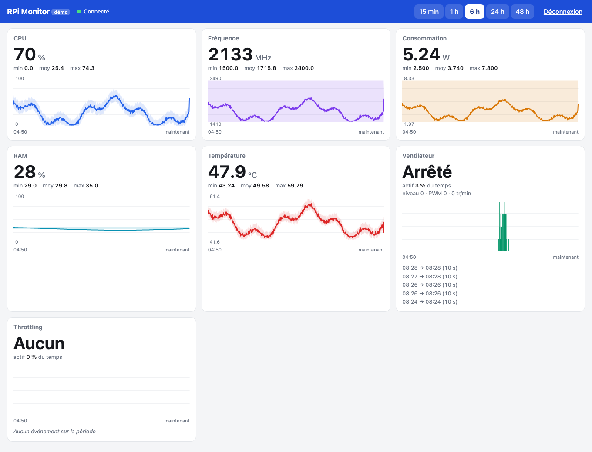

# rpi-monitor-rust

Monitoring de **Raspberry Pi 5**, en **lecture seule**, **sans sudo** et **sans Python**, avec deux interfaces : un tableau de bord dans le **terminal** (TUI) et une **interface Web** alimentée par un **service permanent**. C'est un portage en Rust de [rpi-monitor](https://github.com/laurent-malorean/rpi-monitor), l'application Python d'origine.

## Une expérience : ma première application en Rust

C'est ma première application en Rust, et je ne connais pas le langage. Le but du projet n'est pas seulement le moniteur : c'est de **tester le développement d'une application Rust entièrement menée avec une IA (Claude Code), sans connaître Rust**.

Le cadre est le même que pour le projet Python : un `CLAUDE.md` qui impose la méthode, et une documentation vivante dans `docs/`.

- **TDD strict** : chaque fonctionnalité commence par un test qui échoue, puis le code minimal, puis le nettoyage.
- **Commits atomiques** en Conventional Commits, avec un hook pre-commit qui lance `cargo test` et refuse le commit si un test échoue.
- **Vocabulaire métier** tenu à jour dans `docs/ontology.md`, **bonnes pratiques** dans `docs/kb_dev.md`.

Le code produit par l'IA est donc contrôlé par ses tests et par ces règles, pas par ma lecture du Rust. Les limites de ce mode de travail (ce que les tests ne couvrent pas, ce que je ne peux pas relire) font partie de ce qu'on cherche à mesurer.

## Ce que fait l'application

Sept indicateurs surveillés :

1. **CPU (%)** : charge globale (`/proc/stat`).
2. **Fréquence (MHz)** : fréquence courante du processeur (`cpufreq`).
3. **Consommation (W)** : puissance estimée, somme tension × courant des rails du PMIC (`vcgencmd pmic_read_adc`). C'est une estimation, pas la mesure à l'entrée USB-C.
4. **RAM (%)** : mémoire utilisée (`/proc/meminfo`).
5. **Température (°C)** : température du processeur.
6. **Ventilateur** : activité par périodes de 10 s. Une activation d'une seule mesure reste visible.
7. **Throttling** : sous-tension, fréquence bridée, throttle, limite de température. « En cours » est distingué de « survenu depuis le démarrage ».

Une mesure absente est affichée `--` (ou « indisponible » sur le Web) et n'est jamais comptée comme zéro. Collecte : ventilateur toutes les 500 ms, le reste toutes les secondes.

| | Terminal (TUI) | Service + interface Web |
|---|---|---|
| Lancement | `rpi-monitor` (ou `tui`) | `rpi-monitor serve` |
| Fonctionne sans session SSH | non | **oui** (systemd, 24 h/24) |
| Historique | 30 min, perdu à la fermeture | **48 h glissantes**, conservé après un redémarrage |
| Consultation | dans le terminal | navigateur (ordinateur, tablette, téléphone), plusieurs en même temps |
| Protection | aucune (session locale) | **mot de passe** obligatoire |

## Interface terminal (TUI)


Sept indicateurs empilés : la valeur actuelle en gros à gauche (avec min / max / moyenne), la courbe dans le temps à droite. Elle fonctionne par SSH et reste inchangée.

| Touche | Action |
|---|---|
| `q` | quitter (`Ctrl+C` aussi) |
| `p` | pause de l'affichage (la collecte continue) |
| `r` | remise à zéro de l'historique |
| `w` | fenêtre d'affichage 1 / 5 / 30 min (5 min au départ) |

## Interface Web



- Les 7 indicateurs : valeur actuelle, **min / moyenne / max** sur la période, courbe avec la plage min-max, info-bulle au survol.
- **CPU par cœur** : le chiffre est la moyenne de tous les cœurs, la courbe affiche **un cœur par couleur** (légende, et détail de chacun dans l'info-bulle).
- La **version** du service (commit et date de compilation) s'affiche dans l'en-tête, pour savoir quel binaire tourne.
- **Période au choix** : 15 min, 1 h, 6 h, 24 h, 48 h.
- **Événements** du ventilateur et du throttling (début, fin, durée), détail du ventilateur (niveau, PWM, tr/min), indicateurs de throttling en cours ou survenus depuis le démarrage.
- **Actualisation automatique** chaque seconde ; une donnée indisponible est signalée, et la **perte de connexion** avec le serveur est affichée (bannière, valeurs grisées).
- Adaptée aux écrans d'ordinateur, de tablette et de téléphone, thème clair ou sombre selon le système. Aucun framework ni service externe : la page est embarquée dans le binaire.
- Lecture seule : aucun client ne peut agir sur le matériel.

### Service permanent

`rpi-monitor serve` fait tourner la collecte sans terminal, expose l'API et l'interface Web, sauvegarde l'historique (toutes les 10 min et à l'arrêt) et s'arrête proprement sur SIGINT / SIGTERM. Lancé par systemd, il démarre avec le Pi et redémarre en cas de panne.

```sh
rpi-monitor serve                         # sur le Pi : http://127.0.0.1:8765
rpi-monitor serve --host 0.0.0.0          # accessible depuis le réseau local
rpi-monitor serve --port 9090             # autre port
cargo run -- serve --demo --no-auth       # essai sur Mac, sans Raspberry Pi
```

| Réglage | Option | Variable d'environnement | Défaut |
|---|---|---|---|
| Adresse d'écoute | `--host` | `RPI_MONITOR_HOST` | `127.0.0.1` |
| Port | `--port` | `RPI_MONITOR_PORT` | `8765` |
| Fichier du mot de passe | `--password-file` | `RPI_MONITOR_PASSWORD_FILE` | `password`, à côté de l'exécutable |
| Dossier de sauvegarde | `--data-dir` | `RPI_MONITOR_DATA_DIR` | le dossier de l'exécutable |

Priorité : défaut < variable d'environnement < option. Un port invalide ou occupé donne un message explicite.

**Tout tient dans un seul dossier** : celui où l'on pose l'exécutable contient le binaire, le fichier `password` et la sauvegarde `history.json`.

**Sécurité** : le service n'écoute que sur `127.0.0.1` par défaut ; un tunnel de votre choix permet l'accès hors du réseau local (le service ne dépend d'aucun tunnel en particulier). Comme un tunnel rend le service public, un **mot de passe est obligatoire** (le démarrage est refusé sans fichier `password`, sauf `--no-auth` explicite) : cookie de session aléatoire de 30 jours, 5 échecs par minute au maximum.

### API

JSON, lecture seule, protégée par la session (sauf `health`) :

| Route | Contenu |
|---|---|
| `GET /api/v1/health` | état du service |
| `GET /api/v1/metrics/current` | dernières valeurs, unités, `null` si indisponible |
| `GET /api/v1/metrics/history?period=&key=` | courbes horodatées |
| `GET /api/v1/metrics/stats?period=&key=` | min / max / moyenne |
| `GET /api/v1/metrics/events?period=` | événements ventilateur et throttling |

## Deux modes de capteurs

- **Capteurs réels** : sur le Raspberry Pi (Linux).
- **Mode démo** (`--demo`) : données synthétiques cohérentes (charge qui varie, température progressive, ventilateur, événements de throttling). Il permet de tout tester sans Raspberry Pi, par exemple sur Mac. Il est **activé automatiquement hors Linux**.

## Installation sur un Raspberry Pi

1. **Compiler** (sur le poste de développement) : `scripts/build-pi.sh` remplit `dist/` avec trois fichiers : `rpi-monitor`, `rpi-monitor.service`, `install-service.sh` (aussi recompilé à chaque commit par un hook git).
2. **Copier** ces trois fichiers dans un dossier du Pi, au choix (par exemple `~/rpi-monitor`), avec l'outil de votre choix (client SFTP, `scp`...).
3. **Installer** (sur le Pi) :
   ```sh
   cd ~/rpi-monitor
   sudo sh install-service.sh     # demande le mot de passe d'accès, puis démarre le service
   ```
4. **Consulter** `http://127.0.0.1:8765` depuis le Pi, ou, avec `RPI_MONITOR_HOST=0.0.0.0`, depuis un autre appareil du réseau local (`http://<nom-du-pi>.local:8765`).

Pour lancer à la main plutôt qu'avec systemd : `./rpi-monitor` (TUI) ou `./rpi-monitor serve` dans ce dossier. Ni Python ni `sudo` ne sont nécessaires pour la TUI. Le binaire est un exécutable Linux ARM64 autonome d'environ 1 Mo (glibc 2.36, Raspberry Pi OS Bookworm).

Détails (configuration du port et de l'adresse, tunnel, mise à jour, désinstallation, dépannage) : [docs/deploy-linux.md](docs/deploy-linux.md). Poste de développement et compilation croisée : [docs/install.md](docs/install.md).

## Développement

```sh
cargo run -- --demo     # TUI en mode démo (automatique hors Linux)
cargo run               # TUI avec capteurs réels, à lancer sur le Pi
cargo test              # tests
```

## Architecture


- `src/sensors/` : le trait `Sensors`, les capteurs Linux (`linux.rs`, avec les racines `/sys` et `/proc` injectables pour les tests) et les capteurs de démo (`demo.rs`).
- `src/history.rs` : buffers circulaires (30 min) et agrégation par périodes de 10 s.
- `src/collector.rs` : thread de collecte, indépendant de l'interface.
- `src/render.rs` : fonctions de tracé pures (courbes braille, blocs, échelle, rééchantillonnage, gros chiffres).
- `src/app.rs` : état (pause, fenêtre, reset, touches) et mise en forme des indicateurs.
- `src/ui.rs` : dessin avec ratatui. `src/main.rs` et `src/cli.rs` : point d'entrée.
- `src/archive.rs` : historique long (48 h, horodaté). `src/snapshot.rs` : sauvegarde et restauration.
- `src/server/` : configuration, API JSON (`api.rs`), authentification (`auth.rs`), serveur HTTP. `src/service.rs` : cycle de vie du service. `web/` : interface Web (HTML, CSS, JS, embarquée dans le binaire). `deploy/` : unité systemd.

Pour ajouter une métrique : une méthode dans `Sensors`, une série dans `History`, un `Spec` dans `app.rs`.

## État du projet

- 180 tests automatiques, qui ne nécessitent aucun Raspberry Pi (les lectures `/sys` et `/proc` sont testées sur des arbres de fichiers simulés ; le serveur est testé avec de vraies sockets sur un port éphémère ; la logique de l'interface Web est testée avec Node si présent).
- Le mode démo a été vérifié dans un vrai terminal sur Mac, et la compilation croisée pour le Pi fonctionne.
- Le service et l'interface Web tournent sur un vrai Raspberry Pi 5 (capture ci-dessus) ; ils ont aussi été vérifiés sur Mac en mode démo (navigateur ordinateur et téléphone, perte de connexion, arrêt par SIGTERM).
- **À valider** : l'exécution complète sur un vrai Raspberry Pi 5 (chemins sysfs, `vcgencmd`, service systemd), la mesure de la consommation CPU / RAM / disque du service, et la comparaison de performances avec la version Python (mémoire, CPU, démarrage).

## Documentation

- [CLAUDE.md](CLAUDE.md) : méthode de développement et conventions.
- [docs/ontology.md](docs/ontology.md) : le vocabulaire métier.
- [docs/kb_dev.md](docs/kb_dev.md) : les bonnes pratiques relevées au fil du développement.
- [docs/install.md](docs/install.md) : poste de développement (Mac) et compilation pour le Pi.
- [docs/deploy-linux.md](docs/deploy-linux.md) : déploiement du service sur Linux (systemd, mot de passe, port, tunnel).
- [docs/architecture.md](docs/architecture.md) : architecture du moteur, de l'API et de la sécurité.
