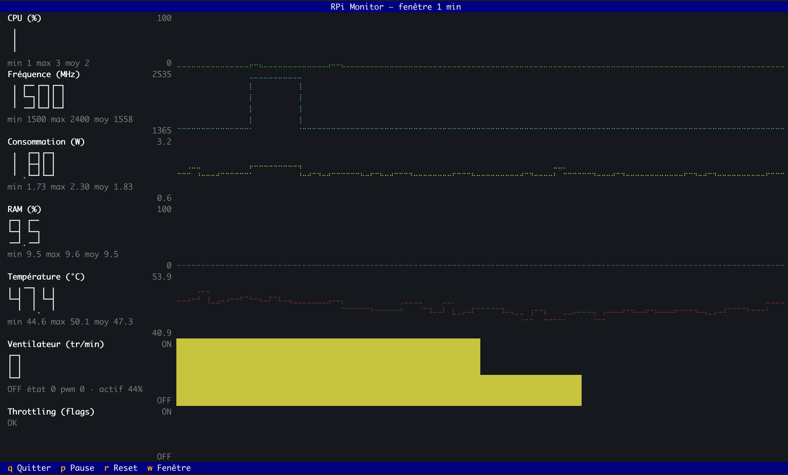
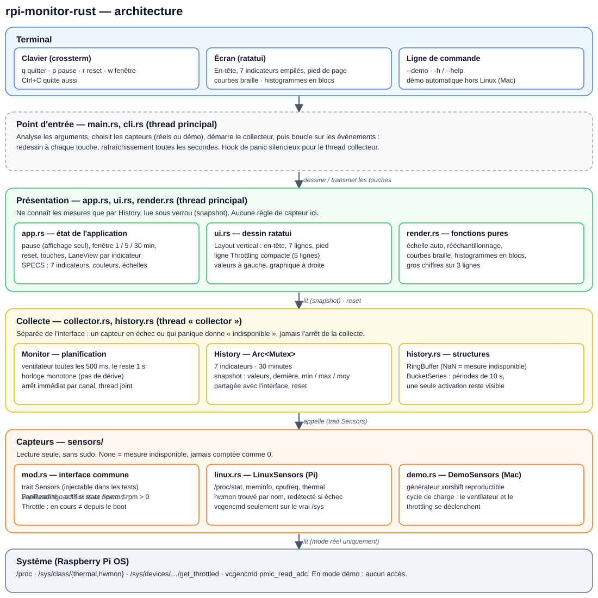

# rpi-monitor-rust

Dashboard de monitoring pour **Raspberry Pi 5**, dans le terminal (TUI), en **lecture seule**, **sans sudo** et **sans Python**. C'est un portage en Rust de [rpi-monitor](https://github.com/laurent-malorean/rpi-monitor), l'application Python d'origine.

## Une expérience : ma première application en Rust

C'est ma première application en Rust, et je ne connais pas le langage. Le but du projet n'est pas seulement le moniteur : c'est de **tester le développement d'une application Rust entièrement menée avec une IA (Claude Code), sans connaître Rust**.

Le cadre est le même que pour le projet Python : un `CLAUDE.md` qui impose la méthode, et une documentation vivante dans `docs/`.

- **TDD strict** : chaque fonctionnalité commence par un test qui échoue, puis le code minimal, puis le nettoyage.
- **Commits atomiques** en Conventional Commits, avec un hook pre-commit qui lance `cargo test` et refuse le commit si un test échoue.
- **Vocabulaire métier** tenu à jour dans `docs/ontology.md`, **bonnes pratiques** dans `docs/kb_dev.md`.

Le code produit par l'IA est donc contrôlé par ses tests et par ces règles, pas par ma lecture du Rust. Les limites de ce mode de travail (ce que les tests ne couvrent pas, ce que je ne peux pas relire) font partie de ce qu'on cherche à mesurer.

## Ce que fait l'application



Sept indicateurs empilés. Pour chacun : la valeur actuelle en gros à gauche (avec min / max / moyenne), et la courbe dans le temps à droite.

1. **CPU (%)** : charge globale (`/proc/stat`).
2. **Fréquence (MHz)** : fréquence courante du processeur (`cpufreq`).
3. **Consommation (W)** : puissance estimée, somme tension × courant des rails du PMIC (`vcgencmd pmic_read_adc`). C'est une estimation, pas la mesure à l'entrée USB-C.
4. **RAM (%)** : mémoire utilisée (`/proc/meminfo`).
5. **Température (°C)** : température du processeur.
6. **Ventilateur** : histogramme par périodes de 10 s. Une activation d'une seule mesure reste visible.
7. **Throttling** : sous-tension, fréquence bridée, throttle, limite de température. « En cours » est distingué de « survenu depuis le démarrage ».

Une mesure absente est affichée `--` et n'est jamais comptée comme zéro.

Collecte : ventilateur toutes les 500 ms, les autres mesures toutes les secondes. Historique de la TUI : 30 minutes. Historique du service : 48 heures glissantes. Affichage rafraîchi toutes les secondes.

### Touches

| Touche | Action |
|---|---|
| `q` | quitter (`Ctrl+C` aussi) |
| `p` | pause de l'affichage (la collecte continue) |
| `r` | remise à zéro de l'historique |
| `w` | fenêtre d'affichage 1 / 5 / 30 min (5 min au départ) |

## Deux modes

- **Capteurs réels** : sur le Raspberry Pi (Linux).
- **Mode démo** : données synthétiques cohérentes (charge qui varie, température progressive, déclenchement du ventilateur, événements de throttling). Il permet de tester toute l'interface sans Raspberry Pi, par exemple sur Mac. Il est **activé automatiquement hors Linux**.

## Service permanent et interface Web

`rpi-monitor serve` fait tourner la collecte 24 h/24 sans terminal, garde 48 h d'historique (sauvegardé, donc conservé après un redémarrage) et sert une **interface Web** consultable depuis un ordinateur, une tablette ou un téléphone : les 7 indicateurs, courbes de 15 min à 48 h, min / moyenne / max, événements du ventilateur et du throttling, actualisation chaque seconde, et indication de la perte de connexion.

```sh
cargo run -- serve --demo --no-auth       # essai sur Mac : http://127.0.0.1:8765
rpi-monitor serve --port 9090      # lit « password » à côté de l'exécutable
```

- Port et adresse réglables (`--port` / `RPI_MONITOR_PORT`, `--host` / `RPI_MONITOR_HOST`) ; l'écoute se fait par défaut sur `127.0.0.1`, un tunnel de votre choix permet l'accès à distance.
- **Mot de passe obligatoire** (fichier `password` à côté de l'exécutable, cookie de session) puisqu'un tunnel rend le service public. Tout le service (binaire, mot de passe, sauvegarde) tient dans un seul dossier, `/opt/rpi-monitor/`.
- Lancé par systemd au démarrage du Pi, redémarré en cas de panne. Installation, mise à jour, désinstallation : [docs/deploy-linux.md](docs/deploy-linux.md). Conception : [docs/architecture.md](docs/architecture.md).
- La TUI reste disponible telle quelle (`rpi-monitor` ou `rpi-monitor tui`), y compris par SSH.

## Lancement

```sh
cargo run -- --demo     # mode démo (automatique hors Linux)
cargo run               # capteurs réels, à lancer sur le Pi
cargo test              # tests
```

## Installation et compilation pour le Pi

Le développement se fait sur Mac (Apple Silicon) et le binaire est compilé pour le Pi depuis le Mac, avec `cargo-zigbuild`. La procédure complète est dans [docs/install.md](docs/install.md). En bref :

```sh
scripts/build-pi.sh        # produit dist/rpi-monitor
scp dist/rpi-monitor <utilisateur>@<pi>:~/
```

Le résultat est un binaire Linux ARM64 autonome d'environ 700 Ko (glibc 2.36, Raspberry Pi OS Bookworm). Ni Python ni `sudo` ne sont nécessaires sur le Pi.

## Architecture



- `src/sensors/` : le trait `Sensors`, les capteurs Linux (`linux.rs`, avec les racines `/sys` et `/proc` injectables pour les tests) et les capteurs de démo (`demo.rs`).
- `src/history.rs` : buffers circulaires (30 min) et agrégation par périodes de 10 s.
- `src/collector.rs` : thread de collecte, indépendant de l'interface.
- `src/render.rs` : fonctions de tracé pures (courbes braille, blocs, échelle, rééchantillonnage, gros chiffres).
- `src/app.rs` : état (pause, fenêtre, reset, touches) et mise en forme des indicateurs.
- `src/ui.rs` : dessin avec ratatui. `src/main.rs` et `src/cli.rs` : point d'entrée.
- `src/archive.rs` : historique long (48 h, horodaté). `src/snapshot.rs` : sauvegarde et restauration.
- `src/server/` : configuration, API JSON (`api.rs`), authentification (`auth.rs`), serveur HTTP. `src/service.rs` : cycle de vie du service. `web/` : interface Web (HTML, CSS, JS, embarquée dans le binaire). `deploy/` : unité systemd.

Pour ajouter une métrique : une méthode dans `Sensors`, une série dans `History`, un `Spec` dans `app.rs`.

## État du projet

- 173 tests automatiques, qui ne nécessitent aucun Raspberry Pi (les lectures `/sys` et `/proc` sont testées sur des arbres de fichiers simulés ; le serveur est testé avec de vraies sockets sur un port éphémère ; la logique de l'interface Web est testée avec Node si présent).
- Le mode démo a été vérifié dans un vrai terminal sur Mac, et la compilation croisée pour le Pi fonctionne.
- Le service et l'interface Web ont été vérifiés sur Mac en mode démo (navigateur ordinateur et téléphone, perte de connexion, arrêt par SIGTERM).
- **À valider** : l'exécution sur un vrai Raspberry Pi 5 (dont le service systemd, la consommation CPU / RAM / disque mesurée) (chemins sysfs, `vcgencmd`), et la comparaison de performances avec la version Python (mémoire, CPU, démarrage).

## Documentation

- [CLAUDE.md](CLAUDE.md) : méthode de développement et conventions.
- [docs/ontology.md](docs/ontology.md) : le vocabulaire métier.
- [docs/kb_dev.md](docs/kb_dev.md) : les bonnes pratiques relevées au fil du développement.
- [docs/install.md](docs/install.md) : poste de développement (Mac) et compilation pour le Pi.
- [docs/deploy-linux.md](docs/deploy-linux.md) : déploiement du service sur Linux (systemd, mot de passe, port, tunnel).
- [docs/architecture.md](docs/architecture.md) : architecture du moteur, de l'API et de la sécurité.
